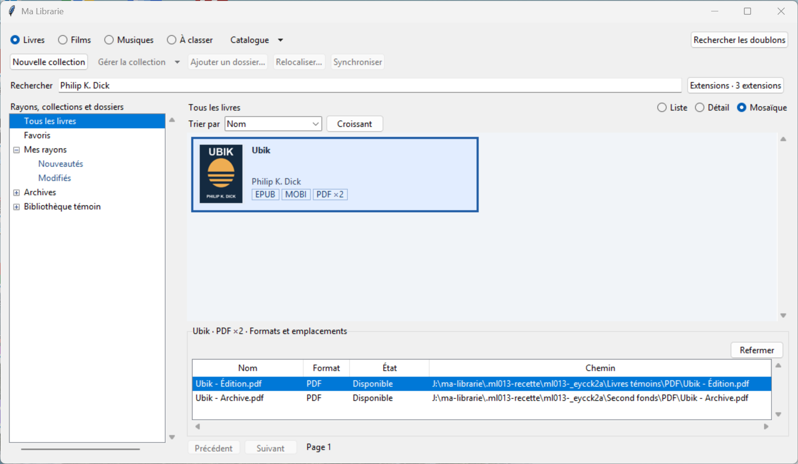

# Recette ML-013 — Regroupement des formats

Recette sous Windows avec Python 3.13, Tkinter, SQLite, Pillow et pypdf. Les essais utilisent des fichiers témoins, dont un EPUB doté d’une couverture créée pour la recette, un MOBI et deux PDF sur des chemins distincts.

| Essai | Résultat observé |
| --- | --- |
| Proposition titre-auteurs | Les variantes de casse et d’espaces concordent. Quatre candidats apparaissent dans le dialogue avec leurs formats et chemins. Le fichier de même titre et d’auteur différent reste hors de la proposition. L’annulation laisse le catalogue intact. La validation après décochage des PDF crée le groupe EPUB et MOBI. |
| Gestion du groupe | Les deux PDF rejoignent ensuite la fiche depuis leur menu individuel, alors que la fiche cible est hors des résultats affichés. La sélection multiple permet de créer une seconde fiche. Le dialogue de fusion indique la fiche finale et les groupes concernés. L’annulation garde les deux fiches, la confirmation les réunit. |
| Mosaïque | Une seule tuile Ubik affiche la couverture et les badges **EPUB**, **MOBI** et **PDF ×2**. Les trois badges ouvrent leurs fichiers et un second clic sur le badge PDF referme les lignes. Les deux PDF ont des noms, formats, états et chemins distincts. |
| Actions individuelles | Les deux chemins PDF sont copiables séparément. Avec le premier PDF sélectionné dans Ma Librarie, le clic droit sur **Ubik - Archive.pdf** ouvre l’Explorateur Windows sur le second PDF. Le contrôle de la sélection de l’Explorateur retrouve son chemin complet. Une fois la source hors ligne, le second PDF reste affiché comme **Hors ligne** et son chemin reste copiable. |
| Liste et Détail | La ligne d’ouvrage déplie quatre fichiers dans Liste. Détail affiche les quatre lignes dans **Formats et emplacements**. Le réglage contextuel rétablit l’affichage individuel. |
| Portée et pagination | Un EPUB partagé par deux collections compte une fois. Les deux PDF distincts comptent deux fois. Une recherche sur un seul PDF retrouve la fiche avec les quatre fichiers. Le filtre PDF ramène le badge à deux fichiers et la branche à un. La pagination compte la fiche comme une entrée. |
| Tags, favoris et doublons | Les rayons retrouvent l’ouvrage via son propre tag ou via le tag d’un fichier visible. La fusion conserve les tags d’ouvrage. Le retrait d’un fichier laisse son favori intact. La recherche de doublons exacts retrouve les deux PDF témoins. |
| Persistance et restauration | Le groupe est retrouvé après relocalisation sur le même volume, synchronisation et réouverture. La restauration v3 rétablit le groupe, ses tags et le réglage. Une sauvegarde v2 produite par ML-012 retrouve son inventaire, son tag et son favori, avec un classement par ouvrage vide. La suite vérifie aussi la reprise v1. |

Les scénarios déclenchent les clics dans les widgets Tk visibles. Le dialogue de proposition a été ouvert et manipulé. Le choix de la fiche cible et les réponses aux confirmations ont été pilotés par le test. La capture provient de la fenêtre Windows et le contrôle de la sélection dans l’Explorateur a été exécuté séparément.

`py -3.13 -X utf8 -B -m unittest discover -s tests -q` a exécuté 47 tests sous Windows. Tous ont réussi.
