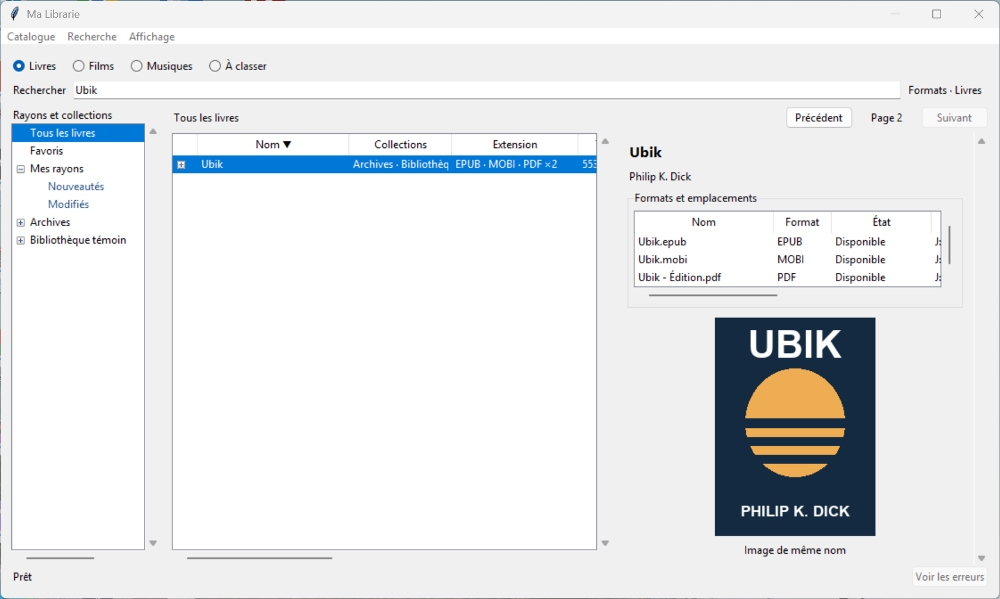

# Recette ML-014 — Menus et navigation

Recette sous Windows avec Python 3.13, Tkinter et SQLite. La capture montre la barre de menus, le filtre **Livres**, la page 2 au-dessus des résultats et le volet de détails d’Ubik.

| Essai | Résultat observé |
| --- | --- |
| Barre de menus | La fenêtre Windows expose les menus natifs **Catalogue**, **Recherche** et **Affichage**. Les anciennes commandes ont été retirées de la rangée de boutons. Les bibliothèques et la recherche restent accessibles directement. |
| Catalogue vide et sauvegardes | **Nouvelle collection…** crée une collection dans **Films** depuis un catalogue vide. La sauvegarde créée depuis le menu se valide. La restauration retrouve le nom de collection sauvegardé. |
| Filtre et doublons | **Filtrer par extension…** ouvre le dialogue. Le préréglage **Films** affiche **Formats · Films** dans la collection et sa branche. **Réinitialiser le filtre** retire l’indication et réaffiche les fichiers auxiliaires. **Rechercher les doublons…** retrouve les deux fichiers témoins. |
| Collection et source | Le menu contextuel de collection permet l’ajout et la synchronisation. Le menu de racine permet la synchronisation ciblée, la relocalisation sur le volume d’origine et l’accès au retrait. Une branche ne reçoit pas les commandes de racine. Le bilan et l’accès aux erreurs restent visibles après un essai hors ligne. Les menus généraux protègent les opérations incompatibles pendant le scan. |
| Clavier et ciblage | **Maj+F10** ouvre le menu de l’élément actif dans l’arbre, en Liste et en Mosaïque. **Regrouper la sélection…** est la première commande pour un lot de livres. Les tests existants vérifient que les commandes de chemin ciblent le fichier sous le pointeur. |
| Reprise de Détail | Un catalogue créé par le code publié de ML-013 (`98dcc3772c0c34b7e0e8d614f2f1868536c5d747`) avec le mode **Détail** s’ouvre en **Liste** avec le volet visible. L’option devient indisponible en **Mosaïque** et reprend son état au retour en Liste. Elle reste mémorisée après réouverture. |
| Tri, pagination et formats | Le sens choisi dans **Affichage → Trier par** est repris par l’en-tête de Liste. **Précédent** est désactivé en début de résultats et **Suivant** en fin de résultats. La navigation reste au-dessus des résultats en largeur normale et passe sous le titre quand le panneau est étroit. Le filtre, la recherche, le tri, la page 2 et la sélection restent en place lors des changements de mode et de volet. Le badge **PDF ×2** ouvre les deux fichiers aux deux largeurs. |

Les scénarios ont déclenché les événements dans les widgets Tk et invoqué les entrées des menus. La saisie de noms, les sélecteurs de fichiers et de dossiers et les confirmations de restauration ont été pilotés par le test. La présence des trois menus natifs a aussi été vérifiée auprès de la fenêtre Windows.

`py -3.13 -X utf8 -B -m unittest discover -s tests -q` a exécuté 49 tests sous Windows. Tous ont réussi.
