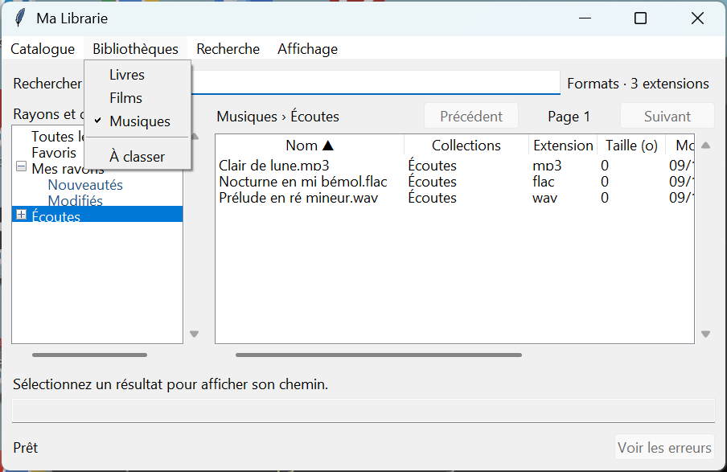

# Recette ML-014a — Menu Bibliothèques

Recette sous Windows avec Python 3.13 et Tkinter, sur des données témoins. La capture montre le menu natif ouvert, **Musiques** coché et le périmètre **Musiques › Écoutes**.

| Essai | Résultat observé |
| --- | --- |
| Souris | Le clic sur **Bibliothèques**, puis sur **Films**, ouvre **Tous les films**. L’indicateur natif passe de Livres à Films. |
| Clavier | **Alt+B**, puis **M**, ouvre **Toutes les musiques**. L’indicateur natif passe à Musiques. Le test envoie les entrées à la fenêtre Windows et vérifie l’état du menu natif. |
| Entrées et fenêtre étroite | Le menu contient **Livres**, **Films**, **Musiques**, un séparateur et **À classer**. La rangée de boutons a disparu. À 850 pixels Tk de large, le champ de recherche et la pagination restent visibles. Le titre indique la bibliothèque et la collection sélectionnée. |
| Recherche et filtre | La recherche **Commun** et le focus du champ sont conservés. Les bibliothèques Livres, Films et Musiques reprennent respectivement leurs filtres MOBI, MKV et MP3 et affichent chacune le fichier attendu. |
| À classer et création | Une collection importée est visible sous **À classer**, puis apparaît dans **Livres** après rattachement depuis son menu contextuel. **Catalogue → Nouvelle collection…** crée une collection dans **Films** quand cette bibliothèque est active. |
| Synchronisation | Le menu Bibliothèques et ses entrées sont désactivés pendant le scan. Une tentative de choisir Livres conserve Films. Le menu est de nouveau disponible à la fin du scan. |

Les scénarios complémentaires ont invoqué les commandes des menus Tk et piloté les sélecteurs de dossiers. La suite `py -3.13 -X utf8 -B -m unittest discover -s tests -q` a exécuté 50 tests sous Windows. Tous ont réussi.
