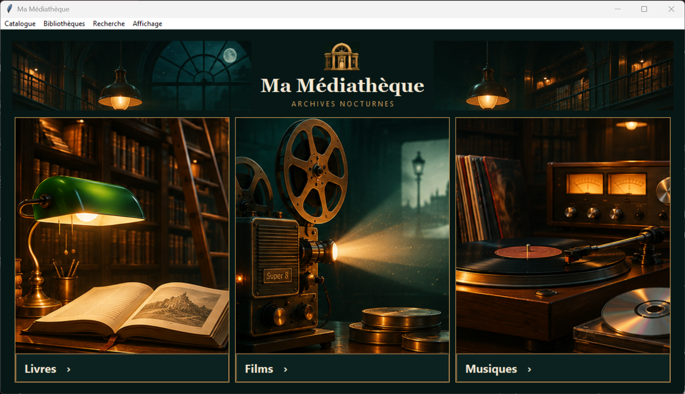
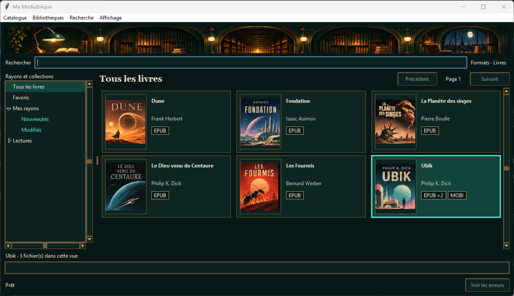
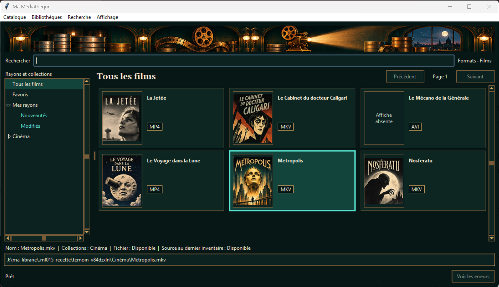
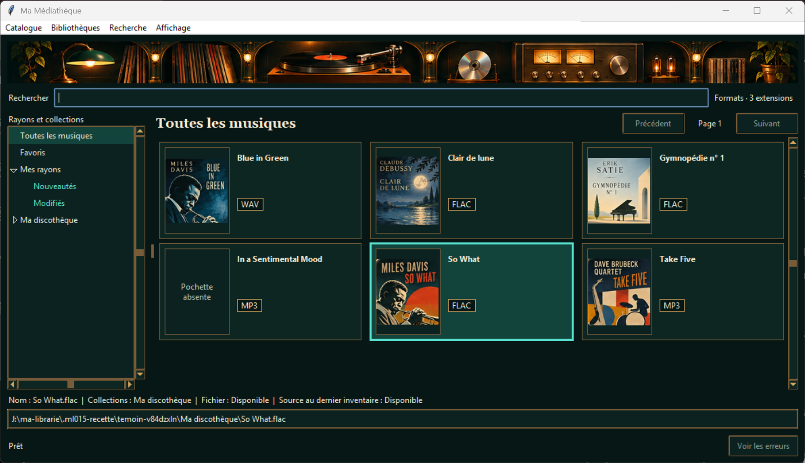
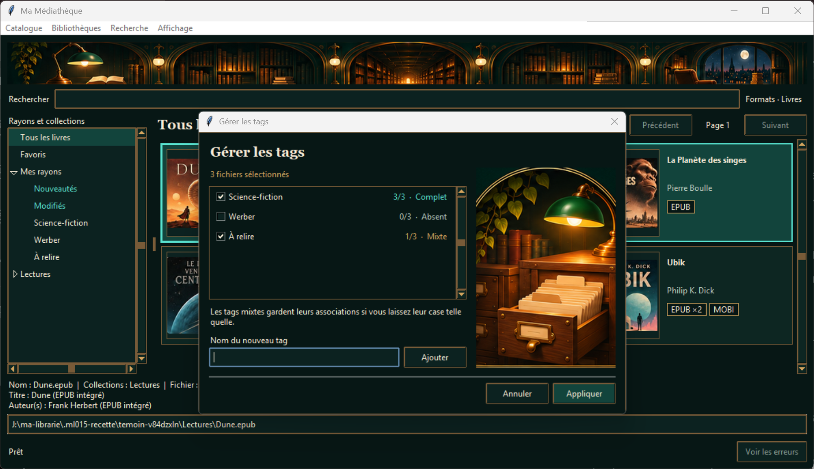

# Recette ML-015 — Habillage Ma Médiathèque

**Verdict GO.** Les cinq vues ont été vérifiées sous Windows avec Python 3.13, Tkinter et Pillow. La suite complète compte 52 tests réussis.

Les cinq PNG ont été ouverts et comparés à la liste de la mission avant de modifier l’application. Chaque fichier correspond à la vue indiquée. L’intégration et les captures suivent le même ordre.

## 1. Accueil

Référence vérifiée · **Ma Médiathèque, archives nocturnes.png**. Elle montre les trois entrées illustrées sous le titre et le décor d’archives.

L’ouverture normale affiche l’accueil. Les trois portes ont été activées par clic sur l’illustration et par **Entrée** sur leur bouton. Chacune ouvre **Tous…** dans la bibliothèque correspondante. **Catalogue → Accueil** permet de revenir aux portes. Le menu **Bibliothèques** conserve sa sélection native, l’accès à **À classer** et son blocage pendant un scan, couverts par les tests de navigation ML-014a.

## 2. Livres

Référence vérifiée · **Ma Médiathèque, bibliothèque nocturne.png**. Elle montre le bandeau de bibliothèque, l’arborescence et les couvertures avec leurs formats.

La grille affiche six ouvrages témoins, dont Ubik avec **EPUB ×2** et **MOBI**. Les couvertures chargent à l’entrée depuis l’accueil. Le filtre **Livres**, la recherche, le tri, la pagination et le passage Liste/Mosaïque ont été vérifiés à 1190 et à 850 pixels Tk de large. La suite rejoue le volet de détails et le dépliage des formats.

## 3. Films

Référence vérifiée · **Ma Médiathèque _ films classiques-2.png**. Elle montre le décor de projection, les affiches et les formats vidéo.

Les affiches témoins proviennent d’images locales de même nom. Le Mécano de la Générale affiche **Affiche absente** avec son titre et son format AVI. Le filtre **Films**, la recherche, le tri, la pagination et les deux modes ont été vérifiés, dont un passage à 850 pixels Tk.

## 4. Musiques

Référence vérifiée · **Médiathèque musicale aux accents jazz-1.png**. Elle montre la platine, les vu-mètres, les pochettes et les formats audio.

Les pochettes témoins sont chargées depuis les images de même nom. **In a Sentimental Mood** affiche **Pochette absente** et le badge MP3. Le filtre FLAC, MP3 et WAV, la recherche, le tri, la pagination et les deux modes ont été vérifiés, dont un passage à 850 pixels Tk.

## 5. Gérer les tags…

Référence vérifiée · **Gérer les tags dans Ma Médiathèque.png**. Elle montre le meuble à fiches, la lampe verte et les trois états du lot.

Le dialogue indique **1/1** sur un fichier et **3/3 · Complet**, **1/3 · Mixte** et **0/3 · Absent** sur trois fichiers. Le test avec trente tags vérifie le défilement jusqu’à la case qui reçoit le focus et la bascule avec **Espace**. **Ajouter**, **Appliquer** et la fermeture sans validation ont été rejoués. Le focus revient au widget de départ et le tag mixte laissé tel quel reste associé à un seul fichier.

## Écarts constatés et méthode

La barre de titre et les menus conservent leur rendu Windows natif. La zone de formats dépliés garde son emplacement sous la grille. Les titres, formats et associations affichés proviennent du catalogue témoin. Les images de films et de musiques suivent la règle du fichier image local de même nom. Les illustrations de catalogue tirées des maquettes ont été utilisées uniquement comme données de recette. Les fichiers livrés dans `catalogue/art` contiennent les décors séparés.

Les captures viennent de fenêtres Windows réelles. Les scénarios ont envoyé des événements de souris et de clavier aux widgets Tk et invoqué les entrées de menu. La pagination a été testée avec deux entrées par page dans le scénario témoin. Les contrôles existants de stockage, de sauvegarde, de synchronisation et de navigation ont été rejoués avec `py -3.13 -X utf8 -B -m unittest discover -s tests -q`.
