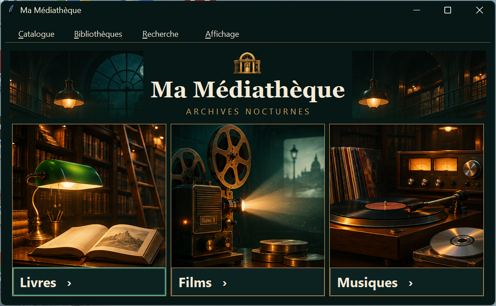
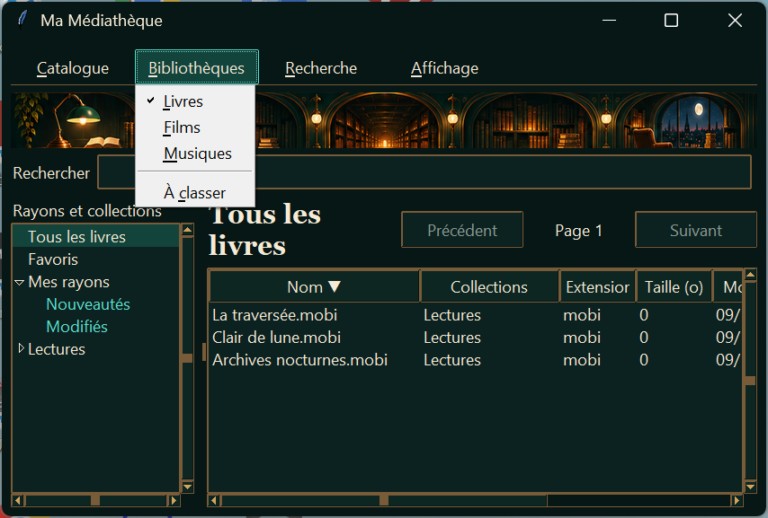
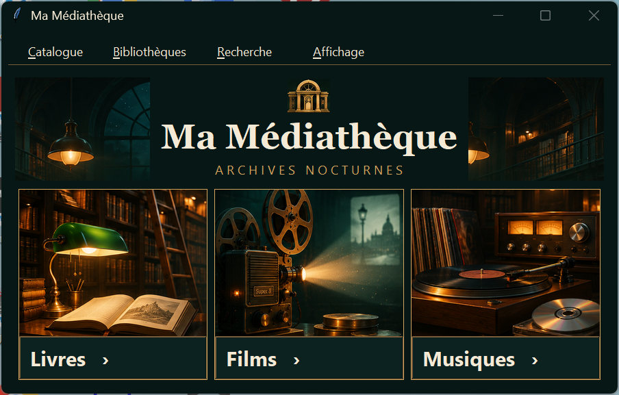

# Recette ML-015a — Barre de titre et menus

**Verdict GO.** La barre de titre et la rangée des menus sont harmonisées avec la palette nocturne. La recette a été exécutée sous Windows 11 25H2 (build 26200), avec Python 3.13 et Tkinter.

## Captures Windows

## Contrôles

| Essai | Résultat observé |
| --- | --- |
| Rendu | Le fond de la barre de titre correspond à `INK` et le texte crème est lisible. La rangée garde le fond sombre sur sa largeur, avec un état visible au survol, au focus et à l’ouverture. L’accueil et Livres ont été contrôlés à largeur normale et à 850 pixels Tk. La frise et le champ de recherche restent à leur place dans la vue Livres. |
| Fenêtre inactive | Le titre reste lisible. Windows atténue les glyphes des boutons de fenêtre. |
| Cadre Windows | Le glissement de la barre de titre déplace la fenêtre. Le glissement du bord droit la redimensionne. Les clics sur **Agrandir**, **Restaurer** et **Fermer** ont été confirmés. Le clic droit sur le titre ouvre le menu système. La réduction et le double-clic ont été confirmés par leurs messages Win32 après des entrées souris injectées non concluantes. |
| Menus et clavier | Les quatre menus s’ouvrent à la souris et via **F10**, flèches et **Entrée**. **Alt+B** ouvre Bibliothèques. Les flèches et **Entrée** sélectionnent Livres, **Échap** ferme le menu et rend le focus à la recherche. Films a été choisi à la souris. **À classer** et Livres ont été choisis au clavier. |
| Sous-menu et état actif | Le sous-menu **Trier par** applique le sens décroissant. Livres est coché dans Bibliothèques après le changement de bibliothèque. **Catalogue → Accueil** ramène à l’accueil. Le test de synchronisation confirme que Bibliothèques est indisponible pendant le scan puis réactivé. |
| Repli DWM | Un test simule le refus de la couleur du texte et vérifie la remise de la couleur de titre au réglage système. |

La rangée est dessinée avec Tk et les menus déroulants restent des popups natifs. Ils reprennent les couleurs système du poste. Le menu Recherche a été vérifié au clavier par F10. L’essai de raccourci direct **Alt+R** sur le poste n’a pas été concluant.

Les couleurs du cadre sont appliquées au handle de la fenêtre via les attributs `DWMWA_CAPTION_COLOR` et `DWMWA_TEXT_COLOR`. [Documentation Microsoft Learn](https://learn.microsoft.com/fr-fr/windows/win32/api/dwmapi/ne-dwmapi-dwmwindowattribute)

`py -3.13 -X utf8 -B -m unittest discover -s tests -q` a exécuté **54 tests**, tous réussis.
