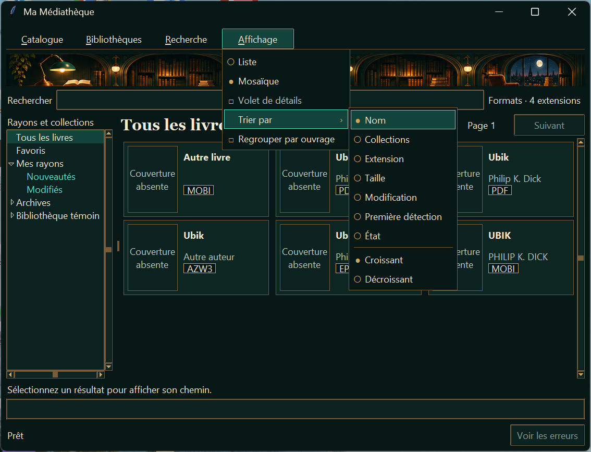
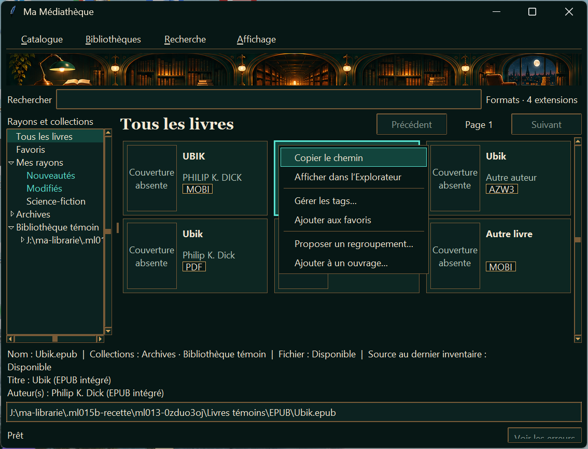
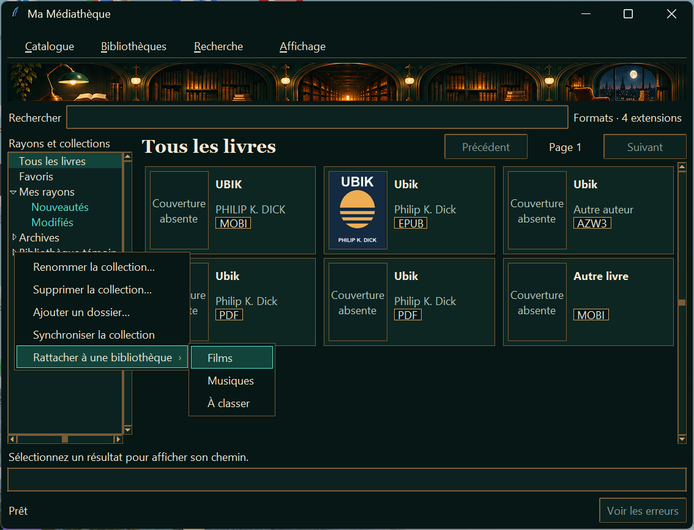
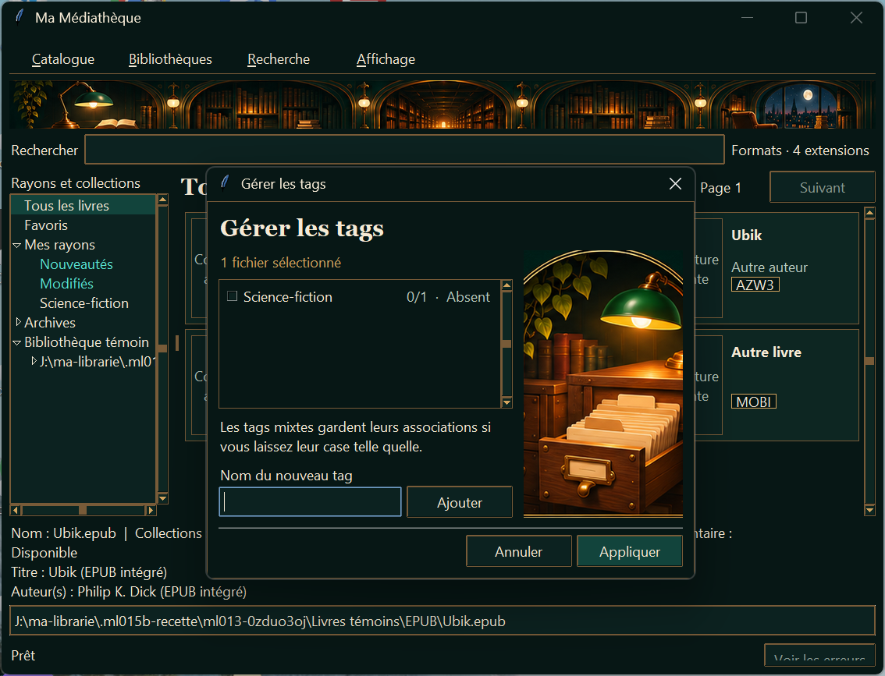
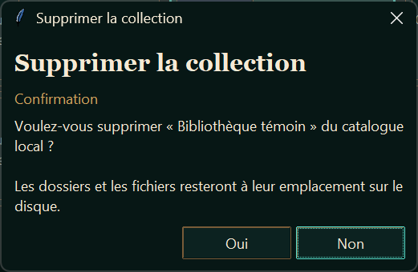

# Recette ML-015b — Harmonisation des menus et dialogues

## Inventaire avant modification

| Famille | Points d’entrée repérés | Rendu à contrôler |
| --- | --- | --- |
| Menus principaux | Catalogue, Bibliothèques, Recherche et Affichage dans `ui.py` | Panneau, surbrillance, entrées désactivées, choix de bibliothèque et de vue |
| Sous-menus | Affichage → Trier par et Collection → Rattacher à une bibliothèque | Flèche, ancrage près des bords, sens du tri |
| Contextes d’arborescence | Collection, dossier source, Mes rayons et rayon dans `ui.py` | Même palette, portée des commandes |
| Contextes de résultats | Liste, tuile, détail, fichier déplié dans `ui.py` et `work_view.py`. Copie de doublon dans `duplicate_view.py` | Même palette, cible, lot et commandes de chemin |
| Tags | `TagDialog` depuis fichier, lot ou ouvrage. Erreur sur un nouveau tag invalide | Titre, contenu et boîte imbriquée |
| Extensions | `ExtensionDialog` depuis Recherche, y compris erreur d’application | Titre, liste, confirmation du filtre |
| Inventaire | `ScanWindow` et fenêtre Voir les erreurs depuis le bilan | Titre, progression, texte |
| Doublons | `DuplicateWindow` depuis Recherche, puis fenêtre Voir les anomalies et menu d’une copie | Titre, liste, texte et contexte imbriqués |
| Catalogue | Progression de sauvegarde, validation ou restauration. Confirmations d’écrasement et de restauration. Erreurs de fichier et d’ouverture du catalogue | Titre, progression, boîtes modales |
| Ouvrages | Proposition, choix de fiche cible, confirmation de fusion, information sans résultat et erreur de validation | Titre, listes, contenu et boîtes imbriquées |
| Saisie et confirmations | Nouvelle collection, renommage de collection, nouveau tag, renommage de tag, suppressions de collection et de tag, retrait de source, fermeture pendant le scan | Saisie, choix par défaut, annulation et retour du focus |
| Erreurs d’application | Extensions, classement, largeur de colonnes, vue, collection, source, relocalisation, regroupement, Explorer et opérations de catalogue | Boîte d’erreur et parent modal |
| Surfaces système | Menu système de la fenêtre, sélecteurs de dossier et de fichier, Explorateur Windows | Rendu et comportement Windows |

## Résultat de la recette Windows

**Verdict PARTIEL.** Les familles de surfaces de l’application ont été ouvertes et leur rendu nocturne vérifié sur Windows 11 25H2. La liaison **Alt+R** ouvre Recherche lorsque Tk reçoit la combinaison. L’essai d’entrée Win32 est resté non concluant et le diagnostic `RegisterHotKey` a renvoyé 1409 pour **Alt+R**, ce qui établit que la combinaison est déjà réservée sur le poste. **F10 → flèches → Entrée** ouvre Recherche. [Codes d’erreur Win32, Microsoft Learn](https://learn.microsoft.com/en-us/windows/win32/debug/system-error-codes--1300-1699-)

| Famille | Observation | Preuve |
| --- | --- | --- |
| Catalogue, Bibliothèques, Recherche et Affichage | Ouverture réelle sur l’accueil et dans Livres. Panneaux verts, texte crème, surbrillance turquoise. Affichage reste lisible avec ses commandes indisponibles sur l’accueil. | [Affichage sur l’accueil](ML-015b_accueil_affichage.png), [Trier par](ML-015b_affichage_tri.png) |
| Trier par et rattachement | Les cascades s’ouvrent aux flèches. Le tri décroissant a été appliqué. Le sous-menu de rattachement s’est retourné à gauche en bord droit du moniteur. Les choix exclusifs et les séparateurs sont visibles. | [Tri](ML-015b_affichage_tri.png), [Rattachement](ML-015b_arbre_rattachement.png) |
| Contextes d’arborescence | Ouverture des menus de collection, racine, Mes rayons et rayon. | [Menu de collection](ML-015b_arbre_rattachement.png) |
| Contextes de résultats | Menus de Liste, tuile, volet Détail et PDF déplié ouverts. Les tests existants rejouent le ciblage du pointeur, les commandes de chemin et la sélection par lot. | [Liste](ML-015b_liste.png), [Tuile](ML-015b_tuile.png) |
| Tags et erreur imbriquée | Titre nocturne. Une saisie vide ouvre une erreur nocturne au-dessus du dialogue de tags. Fermer l’erreur redonne la modalité au dialogue de tags. | [Tags](ML-015b_tags.png), [Erreur imbriquée](ML-015b_erreur_imbriquee.png) |
| Filtre par extension | Titre et liste sombres dans la fenêtre ouverte. | [Extensions](ML-015b_extensions.png) |
| Inventaire | Fenêtre de progression ouverte sur une source témoin et Bibliothèques indisponible pendant le scan. Fenêtre d’erreurs ouverte depuis le bouton du bilan, avec un message témoin. | [Progression](ML-015b_scan.png), [Erreurs](ML-015b_erreurs_scan.png) |
| Doublons et anomalies | Analyse de deux PDF témoins, ouverture du contexte d’une copie et de la fenêtre secondaire d’anomalies. | [Doublons](ML-015b_doublons.png), [Anomalies](ML-015b_anomalies.png) |
| Catalogue | Ouverture de la progression avec un travail témoin et ouverture d’une erreur. Les tests de catalogue rejouent sauvegarde, restauration et refus. | [Progression](ML-015b_progression_catalogue.png), [Erreur de même famille](ML-015b_erreur_imbriquee.png) |
| Ouvrages | Proposition réelle à partir des métadonnées témoins et ouverture du choix de la fiche cible. Les tests existants rejouent validation et fusion. | [Proposition](ML-015b_proposition.png), [Choix de fiche](ML-015b_choix_ouvrage.png) |
| Saisies, confirmations et erreurs | Nouvelle collection ouverte puis annulée. Confirmation de suppression ouverte avec **Non** par défaut, puis annulée. Erreur de catalogue ouverte et fermée. Les chemins d’erreur et de confirmation listés dans l’inventaire utilisent les mêmes composants. | [Saisie](ML-015b_saisie.png), [Confirmation](ML-015b_confirmation.png) |
| Cadre inactif | Le titre conserve sa couleur de fond lorsqu’une autre fenêtre reçoit le focus. | [Titre inactif](ML-015b_titre_inactif.png) |
| Surfaces système | Le menu système, l’Explorateur et les sélecteurs de dossiers ou de fichiers utilisent leurs appels Windows habituels. Les essais d’application ont utilisé des données et des sélections témoins. Aucun contrôle visuel indépendant de ces surfaces n’a été effectué dans cette recette. | Inventaire des appels et tests de navigation |

Les scénarios ont ouvert les fenêtres réelles sur le bureau Windows. Ils combinent des clics Win32 pour la rangée, la sélection de Livres et la fermeture au clic extérieur, et des événements Tk pour les contextes et le clavier. **Alt+B** a été confirmé par entrée Win32. **F10**, les flèches, **Entrée**, **Échap** et **Maj+F10** ont été rejoués. Le focus revient à la recherche après fermeture du menu. La zone utile du moniteur est calculée à partir des coordonnées de l’ancre. [Documentation Microsoft sur les zones de travail des moniteurs](https://learn.microsoft.com/en-us/windows/win32/api/winuser/ns-winuser-monitorinfo)

La suite `py -3.13 -X utf8 -B -m unittest discover -s tests -q` a exécuté **55 tests**, tous réussis.

## Captures principales

