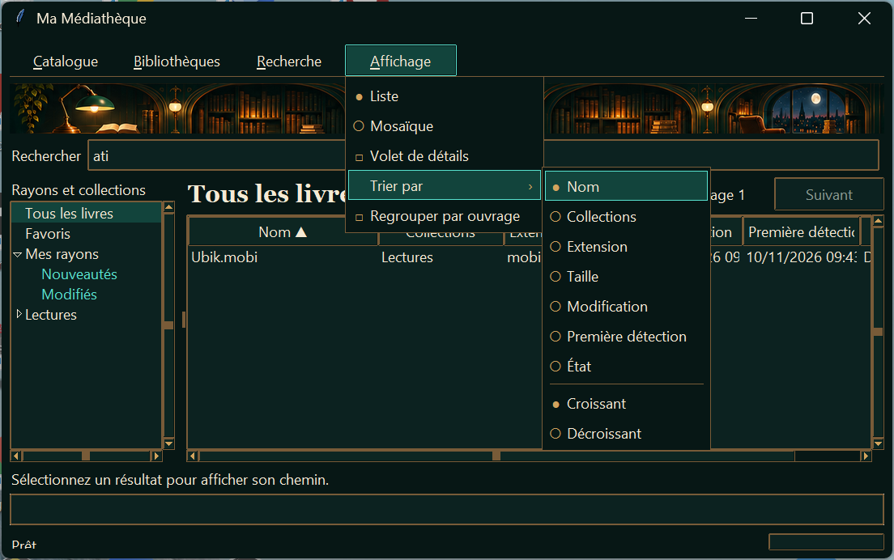
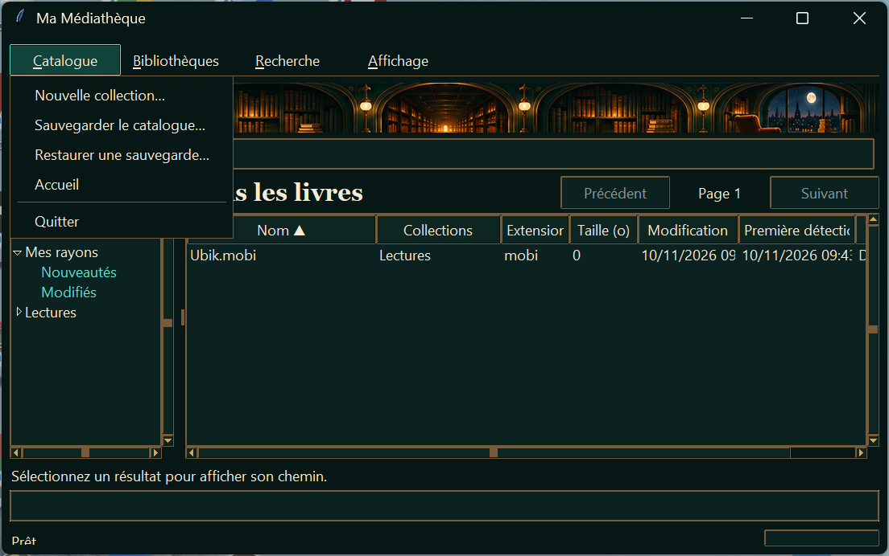
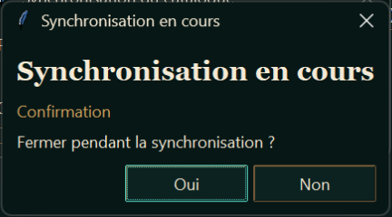

# Recette ML-015c — Navigation des menus et fermeture

**Verdict GO** · 10 novembre 2026 · Windows 11 25H2 (build 26200.9711), Python 3.13.

La recette a utilisé l’interface Tk affichée au premier plan, un catalogue SQLite temporaire et des mouvements, clics et frappes injectés par Win32. Le scan a été maintenu en cours par une pause contrôlée du worker pour pouvoir tester les deux réponses sur chacun des parcours.

## Navigation

| Essai | Résultat |
| --- | --- |
| Survol au repos | Le passage sur les quatre intitulés laisse tous les menus fermés. |
| Balayage après un clic sur **Catalogue** | **Catalogue → Bibliothèques → Recherche → Affichage**, puis retour dans l’ordre inverse. Chaque intitulé ouvre son panneau et remplace le précédent sans nouveau clic. |
| Sous-menu déplié | Depuis **Affichage → Trier par**, le pointeur atteint **Nom**. Le survol de **Recherche**, puis lors d’un second essai celui de **Catalogue**, ferme à la fois le panneau **Affichage** et son sous-menu. Un clic dans **Trier par → Décroissant** applique le tri. |
| Clavier et focus | **F10**, les flèches **Gauche** et **Droite**, **Entrée**, **Échap** et **Alt+B** fonctionnent. Après une ouverture à la souris, **Échap** rend le focus au bouton d’origine. Après le parcours clavier depuis le champ de recherche, le focus revient à ce champ. |
| États et fermeture extérieure | Un clic hors du panneau le ferme. Pendant un scan, le survol de **Bibliothèques**, désactivé, laisse **Catalogue** ouvert. |
| **Alt+R** | Hors recette sur ce poste. Le diagnostic Win32 a renvoyé le code 1409 à la tentative de réservation de la combinaison, déjà réservée. |

Pendant l’ouverture d’un panneau, la position écran du pointeur est relevée pour suivre les déplacements que la capture Tk peut masquer sous Windows. La barre existante décide du changement de menu, et le panneau visible sous le pointeur reçoit la sélection.

## Fermeture

**Quitter** figure en dernière position dans **Catalogue**, sous un séparateur. Il appelle la même méthode que la croix native et reste disponible pendant un scan.

| Situation | Catalogue → Quitter | Croix Windows |
| --- | --- | --- |
| Au repos | Ferme la fenêtre. | Ferme la fenêtre. |
| Scan en cours, **Non** | Affiche la confirmation, puis garde la fenêtre ouverte et le scan se termine. | Même dialogue et même résultat. |
| Scan en cours, **Oui** | Affiche la confirmation, puis ferme la fenêtre. | Même dialogue et même résultat. |

Le rappel Tk de suivi du scan est annulé à la destruction de la fenêtre. La recette rejouée après ce correctif s’est terminée sans erreur Tk.

## Captures Windows

## Suite automatisée

`py -3.13 -X utf8 -B -m unittest discover -s tests -q`

**56 tests réussis.** Le test de régression couvre le survol d’un intitulé désactivé, le remplacement d’un menu avec cascade ouverte et le retour du focus.
