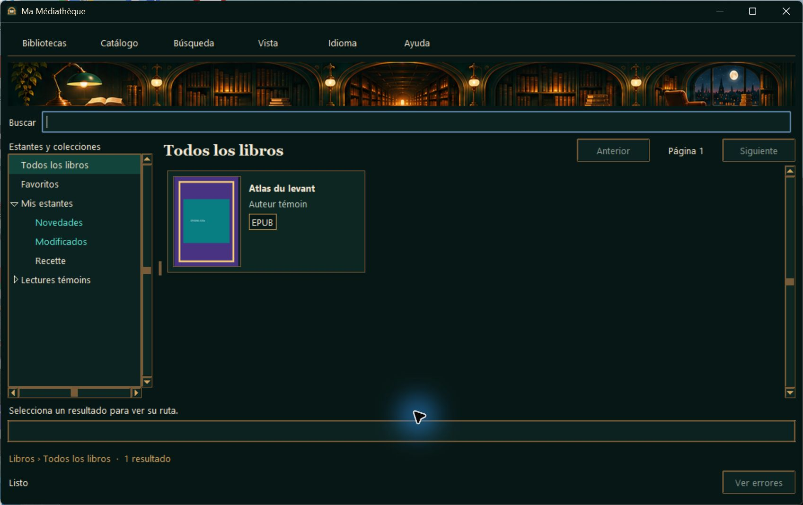

# ML-020a — Recette Windows de `alpha-0.1.20`

**Verdict PARTIEL — 10 novembre 2026.** Les paquets ont été reconstruits et contrôlés sous Windows 11 25H2 x64 (26200.9711) sur le poste de développement. La recette hors ligne sur Windows 11 x64 dépourvu de Python reste à réaliser. La commande de gestion Hyper‑V a renvoyé un refus d’accès et aucun lanceur Windows Sandbox n’était disponible. La publication de la préversion GitHub est conditionnée au GO.

## Version et paquets

La source commune définit `alpha-0.1.20`. PyInstaller et Inno Setup utilisent `0.1.20.0` dans les champs numériques Windows. La lecture des ressources PE x64 confirme `alpha-0.1.20` dans les champs textuels `FileVersion` et `ProductVersion` des deux exécutables, après retrait du remplissage de fin de champ d’Inno Setup. Le registre Windows indique `DisplayVersion = alpha-0.1.20` à l’installation et après réinstallation. L’identité de l’installateur et les chemins d’installation et de données restent ceux de ML‑020. [Documentation Inno Setup sur la version textuelle du fichier](https://jrsoftware.org/ishelp/topic_setup_versioninfotextversion.htm) · [Version textuelle du produit](https://jrsoftware.org/ishelp/topic_setup_versioninfoproducttextversion.htm)

Les livrables se trouvent dans `dist/windows/alpha-0.1.20/`. Le dossier autonome `Ma-Mediatheque/` accompagne les fichiers ci-dessous. L’archive a passé le contrôle d’intégrité ZIP et son exécutable est identique à celui du dossier autonome. Les deux empreintes recalculées correspondent à `SHA256SUMS.txt`.

| Livrable | SHA‑256 |
| --- | --- |
| `Ma-Mediatheque-alpha-0.1.20-windows-x64.zip` | `e6c8c959b3ad080fd746c2a1720f1aad0aabc02ddbcab905100ec5aa9665294c` |
| `Ma-Mediatheque-alpha-0.1.20-windows-x64-setup.exe` | `ea1feb8c6bae581630133008022853d5510849e4ed4413125dd0673778bbb629` |

`Get-AuthenticodeSignature` a renvoyé `NotSigned` pour l’application et l’installateur. Le comportement de SmartScreen reste à relever dans la VM.

## Contrôles sur le poste de développement

- **ZIP autonome.** Lancement avec un PATH limité à System32, sans commande `python.exe` ni `py.exe` accessible par ce PATH. Le processus a chargé Python, SQLite, Tcl/Tk et Pillow depuis son propre dossier `_internal`. Le poste possède Python pour le développement.
- **À propos.** Le dialogue de l’exécutable extrait indique exactement `alpha-0.1.20`, avec le logo Trucabule.
- **Catalogue existant.** Sans réinventaire, le ZIP affiche en espagnol l’EPUB déjà indexé « Atlas du levant », son auteur et sa couverture intégrée en mosaïque. Le rayon témoin « Recette » est visible.
- **Cycle de l’installateur.** Installation, réinstallation et désinstallation sous le compte courant, avec un emplacement d’installation et un profil de données témoins. La cible du raccourci Démarrer a été vérifiée, ainsi que la création du raccourci Bureau facultatif à la réinstallation. La désinstallation a retiré les binaires, l’entrée Windows et les raccourcis. Les SHA‑256 du catalogue et de sa sauvegarde sont restés identiques à chaque étape.
- **Tests existants.** `py -3.13 -X utf8 -B -m unittest discover -s tests -q` a exécuté 63 tests avec succès.

## Protocole à rejouer dans la VM

1. Transférer le ZIP, l’installateur, `SHA256SUMS.txt` et `Temoins-VM-ML-020a.zip` vers une VM Windows 11 x64 propre. Ouvrir une session standard, confirmer l’absence d’installation Python (distinguer un alias Microsoft Store d’un interpréteur installé), puis couper le réseau. Recalculer les deux empreintes avec `Get-FileHash -Algorithm SHA256 -LiteralPath <fichier>` et les comparer au manifeste.
2. Dans ce profil jetable, avant le premier lancement et si le dossier cible est absent, copier le dossier `MaLibrarie` des témoins dans `%LOCALAPPDATA%\`. Extraire le ZIP applicatif en entier et ouvrir `Ma-Mediatheque.exe`. Relever tout avertissement Windows. Ouvrir **Libros → Todos los libros** et vérifier la reprise d’« Atlas du levant » en mosaïque, l’espagnol, le texte agrandi d’un cran, le favori et le rayon « Recette », sans lancer d’inventaire. Le chemin source du catalogue témoin pointe vers le poste de développement.
3. Dans le ZIP lancé, passer par les trois langues, vérifier le rendu de l’accueil, des menus, de l’aide et du logo, puis relever `alpha-0.1.20` dans **Aide → À propos**. Ajouter le dossier `Livres` des témoins à une nouvelle collection de la VM et le synchroniser. Vérifier la couverture intégrée de l’EPUB et rechercher `Constellation Vermeille` puis `Alice Témoin` dans cette collection. Ces deux recherches doivent retrouver `temoin.pdf` grâce à ses métadonnées PDF.
4. Fermer le ZIP et lancer l’installateur. Depuis le menu Démarrer, contrôler l’icône et lancer l’application installée. Vérifier `alpha-0.1.20` dans À propos et dans les applications installées de Windows. Vérifier que la version installée retrouve le même catalogue avec ses réglages, la couverture et le PDF indexé, sans synchronisation.
5. Une fois l’application fermée, calculer les SHA‑256 de `%LOCALAPPDATA%\MaLibrarie\catalogue.sqlite3` et de `sauvegarde temoin.sqlite3` dans le même dossier. Réinstaller, vérifier les empreintes, puis désinstaller et les vérifier de nouveau. Confirmer la disparition des binaires et raccourcis. Relancer le ZIP pour confirmer la reprise des données conservées. Consigner les résultats et capturer le menu Démarrer, À propos et les éventuels avertissements Windows.
